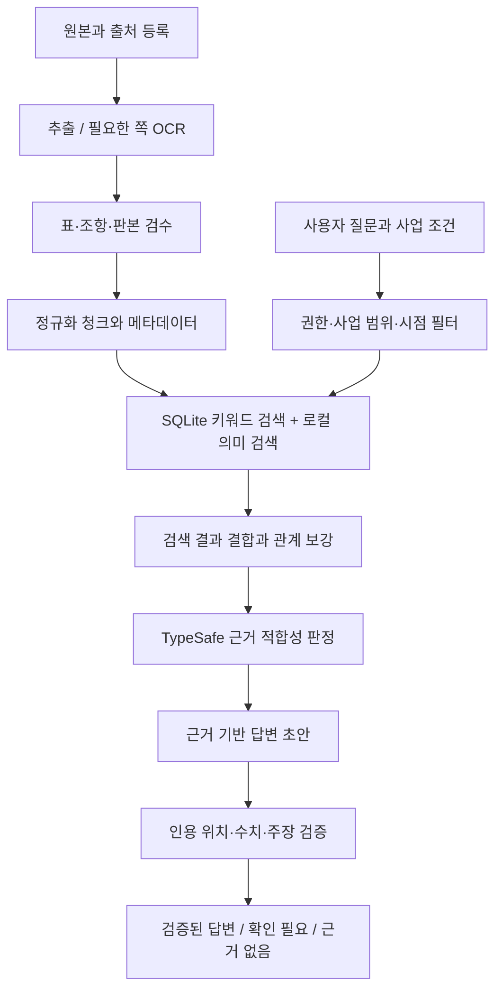

# 공공 IT 사업 챗봇: 자료 점검 결과와 RAG 구성안

작성일: 2026-10-13. 운영 조건: 사내 PC/서버의 소규모 시험 운영, 현재 공개 자료로 시작. 향후 사내 자료 추가 절차는 별도 `자료추가_운영가이드.md`를 따른다.

## 1. 권고와 이번 작업의 범위

**문서의 출처·판본·조항·쪽을 보존하는 하이브리드 RAG로 시작하고, 요구사항–평가기준–산출물 관계는 작은 관계 테이블로 추가하는 구성을 권한다.** 초기부터 대규모 GraphRAG나 전체 문서의 자동 온톨로지 생성을 도입할 필요는 없다. 현재의 주된 장애물은 데이터 양보다 스캔 문서, 잘못 추출된 글자, 중복본, 적용 범위와 판본 정보다.

이번에 한 일은 원본 파일 점검, PDF 페이지별 텍스트 추출량 점검, 해시 중복 확인, 후보 자료 목록 작성, TypeSafe 인용 검증 기능 시험, 구성·비용·자료 추가 절차 설계다. **OCR 전체 처리, 임베딩 생성, 검색 DB 구축, 챗봇 배포, 최신 법령 재검증은 아직 수행하지 않았다.** 기존 조사보고서의 현행성 기록은 참고했지만 이번 점검에서 독립적으로 재검증한 것으로 표시하지 않았다.

요청한 Filesystem MCP는 이번 세션의 호출 가능한 도구 목록에 파일 접근 도구가 노출되지 않았고 플러그인 검색에서도 일치하는 연결을 확인하지 못했다. 같은 로컬 폴더를 PowerShell·Python 파일 접근으로 점검했다. 따라서 Filesystem MCP를 사용했다고 보고하지 않는다. 향후 해당 MCP가 연결되면 자료 수집 입구로 사용할 수 있다. 검색 인덱스·임베딩·인용 검증은 별도로 구성해야 한다.

## 2. 실제 파일 점검 결과

생성한 `rag_assessment`와 점검 스크립트를 제외한 기존 파일을 기준으로 한다. 기존 폴더에는 하위 자료 디렉터리가 없었다.

| 점검 항목 | 결과 | 해석 |
| --- | ---: | --- |
| 기존 파일 | 140개 / 약 105.6 MiB | 대부분 수집·추출·검증 산출물이며 독립 문서 140종이 아님 |
| PDF | 20개 / 1,703쪽 | 동일 바이트 PDF 중복 2쌍 포함 |
| PDF 중복 제거 후 | 18개 / 1,422쪽 | 물리적 PDF 쪽 기준 |
| TXT / HTML | 44개 / 42개 | 본문, 조회 화면, 오류 응답, 게시판 메뉴를 구분해야 함 |
| HWP | 1개 | 공식 RFP 작성 예시 부록; 추출 Markdown 존재 |
| 텍스트 80자 미만 PDF 페이지 | 중복 포함 206쪽 / 중복 제거 후 167쪽 | 표지·빈 쪽도 포함하므로 전부 OCR 오류라는 뜻은 아님 |
| 이미지형 PDF | `swit_law_guide.pdf` 83쪽 전체 | 페이지 텍스트 0자; 전체 OCR 필요 |
| ZIP | 1개, 내부 43개 파일 모두 기존 파일과 해시 일치 | ZIP을 다시 풀어 함께 색인하면 중복 발생 |
| 색인 후보 단위 | 28개 | 본문·별표·가이드·예시를 나눈 후보 단위. 운영 승인 문서 수가 아님 |

확인된 주요 문제와 조치는 다음과 같다.

| 자료·파일 | 실제 관찰 | 조치 |
| --- | --- | --- |
| `swit_law_guide.pdf`, `swit_law_guide_full.txt` | 2025.11 가이드 83쪽이 이미지형. TXT는 페이지 표식만 있고 본문 없음 | 전체 OCR 후 표·숫자·예외 문구를 이미지와 대조. PDF 검색 완료로 표시하지 않음 |
| `nipa_ict_0.pdf`, `nipa_ict_1.pdf`와 대응 TXT | 2014.3 가이드. 표지 이미지는 한글로 정상이나 추출문에는 다른 문자와 잘못된 숫자가 나타남 | 단순 UTF-8 변환으로 해결하지 않음. 글꼴 매핑 복구 또는 OCR 후 참고 자료로 분리 |
| `local_decree.txt`, `national_decree.txt`, `public_rules.txt`, `sw_act.txt` | 각각 11자 수준의 Error 응답 | 색인 제외. 대응 `_body.html`·`_body.txt` 사용 |
| `local_award.txt` | 210바이트의 조회 응답. 별도 486쪽 전문 PDF 존재 | 전문 PDF와 페이지 표식이 있는 전문 TXT를 연결 |
| `*_shell.*`, `D*_official_page.html`, 홈페이지·자료목록 | 판본 확인·다운로드 추적에는 유용하지만 본문 근거가 아닌 화면이 섞임 | provenance 기록에 보관하고 답변 근거 색인에서 제외 |
| 별표·평가표 PDF/TXT | 글자는 추출되지만 표가 행·열 단위로 흩어지고 수식에 특수 글리프가 나타남 | 열 제목·주석을 각 행에 연결. 계산식은 이미지 대조 후 코드로 구현 |
| `swit_rfp_example_parsed.md` | HWP RFP 예시의 구조가 추출됨. OOO·20xx·선택 문구 존재 | 템플릿 자료로 취급. 사업의 실제 요구사항이나 법적 의무로 전환하지 않음 |
| `nipa_requirements_1.pdf` | 표지 2012.12, 313쪽 | 요구사항 작성 사례 참고. 현재 의무 설명의 단독 근거에서 제외 |
| `공공정보화사업_단계별_사업관리가이드(2023.2).pdf` | 108 PDF쪽, 기획·구축·감리·PMO·운영 목차와 일러두기 확인. 일러두기는 2022.12 법령 기준 명시 | 수행 절차 참고 자료로 포함 가능. 공식 원본 URL·발행 정보 보강, 현재 규정 인용 대조. 펼침면의 인쇄쪽을 별도로 매핑 |
| 기존 조사보고서·TypeSafe 결과 JSON | 조사자의 해석과 작업 분류 기록 | 탐색·검증 이력으로 보관. 원문보다 우선하는 독립 근거로 취급하지 않음 |

PDF·TXT끼리 내용상 중복되는 자료까지 모두 같은 방식으로 임베딩하면 특정 자료가 검색 상위권을 독점한다. 문서 ID 하나 아래 원본과 추출본을 연결하고 정규화한 본문만 한 번 색인해야 한다.

전체 파일과 SHA-256은 `file_inventory.csv`, PDF별 모든 페이지 추출량은 `pdf_quality.json`, 후보별 조치는 `source_actions.csv`와 `source_manifest.json`에 있다. 해시가 같다는 것은 파일 동일성만 의미하며 문서 내용·현행성의 정당성을 보장하지 않는다.

## 3. 목적별로 부족한 데이터

**공식 기준 안내용 시험 RAG는 시작할 수 있다. 실제 프로젝트 문서 작성과 회사의 수행 능력을 설명하는 챗봇까지 운영하기에는 추가 근거가 필요하다.** 모든 자료가 모일 때까지 시험을 미룰 필요는 없으며, 답할 수 있는 범위를 명시하면 된다.

| 질문 영역 | 현재 보유 범위 | 부족한 부분 | 우선 조치 |
| --- | --- | --- | --- |
| 공공기관 RFP 작성 | SW 법제도·계약·평가 지침, RFP 예시 HWP, 오래된 요구사항 가이드 | 사업 유형별 최신 요구사항 상세화 자료, 실제 기관 RFP·정정공고·질의답변 묶음 | 보유 자료 OCR·정규화 후 공개 RFP 사례 5~10건부터 추가 |
| IT 제안서 작성 | 평가기준·별표·자가점검 관련 공식 자료 | 실제 승인된 제안서, 평가항목별 서술 사례, 정량 증빙, 제안요청서–제안서 대응표 | 공개 사례/허용된 익명화 사례 확보. 현재는 구성 방법·근거 안내만 답변 |
| 프로젝트 수행 | 단계별 사업관리 가이드, 관리감독 지침 | 실제 수행계획·WBS·품질계획·테스트·검수·변경관리·운영 인수인계 산출물과 승인 이력 | 우선 공공 가이드의 수행 흐름을 제공하고 향후 사내 승인본 추가 |
| 회사 역량·실적 | 이번 폴더에서 사내 원본 확인되지 않음 | 실적증명·인력 경력·자격·기술자산·표준방법론·제품/공급 협약의 유효 정보 | 지금은 “등록 자료 없음”으로 응답. 임의 실적·인력 수 생성 금지 |
| 기술·보안 세부 설계 | 구축·운영 지침에 일부 원칙 존재 | 프로젝트별 보안 요구, 개인정보·접근성·데이터·클라우드·성능 기준과 실제 아키텍처 | 대상 사업에 필요한 자료부터 추가. 일반 설명을 프로젝트 의무로 표시하지 않음 |
| 대가·기간·산정 | 일부 법제도·RFP 작성 원칙 | 최신 산정 자료, 사업 예산 전제, FP/SLA·장비 단가·산정 내역 | 공식 최신 자료와 입력값 확보 후 검증된 코드 계산 |
| 적용 대상과 판본 | 12개 핵심 근거의 기존 조사 기록 | 조항별 적용 대상, 예외, 공고일·시행일·부칙, 발주기관 계약 규정의 기계 판독 데이터 | 국가·지방·공기업 등 적용 축과 날짜를 등록. 본문 조회 성공만으로 현행 판정하지 않음 |
| 평가 데이터 | 없음 | 질문, 정답 근거, 답변 불가 사례, 판본 혼동 사례 | 평가 초안 30개를 작성했으며 담당자가 정답 근거를 확정해야 함 |

특히 현재 보관된 조달청 별표는 일부다. 파일에 없는 개발·운영 사업별 평가표, 기술적용계획표와 제출 서식 등은 “법령 본문이 있으니 첨부도 모두 있다”고 추정하지 않고 별도 수집·검증한다. NIA CBD 표준 산출물 가이드 등 기존 보고서의 미확인 항목도 원문 확보 전에는 근거로 사용하지 않는다.

위의 5~10건은 초기 사례 다양성을 확보하기 위한 권장 수이며 법적 기준이나 정확도 보장 조건이 아니다. 개발·운영유지관리·장비 구매·컨설팅, 국가·지방·공공기관 등 실제 사용자의 사업 범위를 기준으로 고른다.

## 4. 권장 기술 구성

운영 조건상 첫 버전은 아래 구성이 적합하다. DB를 여러 개 설치하거나 문서 전체를 매 질문마다 모델에 보내는 비용을 피할 수 있다.

| 역할 | 첫 버전 선택 | 선정 이유·운영 한계 |
| --- | --- | --- |
| 원본 보관 | 현재 로컬 폴더 + 불변 원본/해시/manifest | 재추출·인용 확인 가능. MCP는 선택한 폴더를 읽는 수집 수단 |
| 문서 추출 | PyMuPDF, HTML 본문 파서, HWP/HWPX 파서 | 페이지·조항 구조 유지. 스캔과 글꼴 오류는 OCR 경로로 전환 |
| OCR | 한국어를 지원하는 로컬 OCR 엔진 + 페이지 이미지 검수 | API 과금 없이 처리 가능하지만 장비·설치·검수 시간이 듦. 엔진 선택은 대표 페이지에서 비교 후 확정 |
| 메타데이터·키워드 검색 | SQLite + FTS5 BM25 | 설치·운영 부담이 작음. 한국어는 형태소 기반 토큰을 별도 검색 필드에 저장하고 부분 문자열 검색을 보조 |
| 의미 검색 | 로컬 `BAAI/bge-m3` 임베딩 + NumPy 코사인 전수 검색 | 다국어 모델. 작은 코퍼스는 별도 벡터 서버 없이 시작. CPU 처리 시간은 측정 필요 |
| 검색 결합 | 키워드·벡터 결과의 RRF, 문서 다양성 제한 | 조항·요구사항 ID의 정확한 검색과 표현이 다른 질문을 함께 처리 |
| 근거 판정 | TypeSafe `jev-1.13.0` Choice/Noul/Score | 제한된 후보의 관련성·모순·근거 지지 여부 판단. 법적 적용·사실의 진실성 보증은 아님 |
| 답변 생성 | 유료 `gemini-3.1-flash-lite` API를 초기 비교 후보로 사용 | 아래 비용 계산 기준. 한국어 문서 작성 품질·근거 준수는 평가 세트로 검증 후 채택 |
| 서버·화면 | Python FastAPI + 간단한 챗 화면 | 근거 카드와 PDF 해당 쪽/조항, 답변 불가 이유를 표시 |
| 관계 데이터 | SQLite 관계 테이블 | 요구사항–평가항목–산출물–근거 연결. 검증된 관계만 저장 |

BGE-M3는 공식 모델 카드상 1,024차원, 다국어 모델이며 MIT 라이선스다. 이는 한국어 공공조달 검색 성능을 보증하는 수치는 아니다. 1만 청크의 float32 벡터 자체는 약 41 MB지만 모델 가중치·메타데이터·검색 과정의 메모리는 별도로 필요하다. [BGE-M3 공식 모델 카드](https://huggingface.co/BAAI/bge-m3)

FTS5는 BM25와 trigram 검색을 지원한다. trigram의 3자 미만 검색 제한 때문에 “SW”, “FP” 같은 짧은 용어와 요구사항 ID는 정확 일치·별도 토큰 검색으로 처리한다. SQLite 기본 영문 토큰화만으로 한국어 품질이 충분하다고 가정하지 않는다. [SQLite FTS5 공식 문서](https://sqlite.org/fts5.html)

TypeSafe를 사용하지 않는 비교군도 반드시 둔다. 외부 전송을 제한하는 자료가 추가되면 로컬 `bge-reranker-v2-m3`를 재정렬 후보로 시험하고, 해당 자료를 TypeSafe에 보내지 않는 경로를 구성한다. 이 모델은 공식 모델 카드상 다국어 재정렬 모델이다. [공식 모델 카드](https://huggingface.co/BAAI/bge-reranker-v2-m3)

직원이 공동 사용하고 권한·문서 수·검색 부하가 커지면 PostgreSQL + pgvector로 메타데이터·벡터·관계를 통합하는 전환을 검토한다. 한국어 키워드 검색은 별도 토큰화/BM25 구성을 유지한다. pgvector 자체가 한국어 BM25 엔진을 제공하는 것은 아니다. 필요해지기 전에는 대규모 검색 서버를 추가하지 않는다. [pgvector 공식 문서](https://github.com/pgvector/pgvector), [PostgreSQL 행 접근 정책](https://www.postgresql.org/docs/current/ddl-rowsecurity.html)

## 5. 수집·검색·답변 방식

1. **정규화**: 법령은 조–항–호, 가이드는 절·소제목·문단, 표는 표 제목–열 제목–행–주석을 기본 단위로 한다. 긴 조항만 의미 단위로 나누고 예외·단서는 함께 유지한다. 청크 크기는 400~800 모델 토큰을 시작점으로 평가하며 한국어 문자 수와 토큰 수를 동일하게 취급하지 않는다.
2. **검색 전 필터**: 기관 분류, 사업 유형, 발주/입찰/수행 관점, 질문 기준일을 반영한다. 사용자가 지정하지 않은 사업 조건이 결과에 영향을 주면 추가 질문하거나 조건별 답을 표시한다. 승인된 적용 범위 정보가 없으면 모델이 추정한 범위를 확정 규칙으로 쓰지 않는다.
3. **하이브리드 검색**: 키워드 20개 + 의미 검색 20개를 시작값으로 가져와 RRF로 합친다. 같은 문서의 유사 청크는 제한하고, 조항의 부모 문맥·주석·관련 별표를 보강한다. 재정렬/근거 판정 후보 8~12개, 답변 근거 4~8개는 초기 튜닝 값이다.
4. **TypeSafe 판정**: 질문과 후보 텍스트를 state에 넣고 관련성, 답변 근거 충분성, 주장과의 모순을 독립 질문으로 묶는다. 같은 state를 공유하는 질문은 한 요청에 처리한다. 지지 판정만으로 질문 조건·시행 시점 확인을 생략하지 않는다.
5. **답변 생성**: 자료에 있는 사실, 공식 원칙, 참고 가이드, 작성 예시를 구분해 표현한다. 근거 없는 회사 실적·현재 인력·필수 제출조건은 생성하지 않는다. 초안의 사업별 빈칸은 `[사업 조건 확인 필요]`로 유지한다.
6. **출력 검증**: 모델이 지정한 문서·청크 ID가 실제 검색 결과에 있는지, 사용자에게 읽기 권한이 있는지 코드로 확인한다. 직접 인용문은 원문 문자열 대조, 숫자·배점·날짜는 대응 원문 필드 대조, 계산은 검증된 코드로 수행한다. 이후 필요한 주장–근거 관계만 TypeSafe로 확인한다.
7. **답변 불가 처리**: 근거 없음, 판본 불확실, 상충 문서, 적용 조건 미상은 각각 사유를 표시한다. 추가 검색으로 해결되지 않으면 현재 자료로 확정할 수 없다고 답하고 필요한 문서를 제시한다. 검증 서비스 오류를 무조건 통과로 처리하지 않는다.

필수 메타데이터: `document_id`, `version_id`, `source_url`, `source_sha256`, `kind`, `published_at`, `effective_from/to`, `verified_at`, `currency_status`, `scope`, `stage`, `role`, `project_id`, `acl_group`, `external_ai_policy`, `article_path`, `pdf_page`, `printed_page`, `table_id`, `source_span`, `parser_version`, `ocr_review_status`.

공식 규정·가이드·예시·사내 규칙의 순서를 단순 점수 하나로 합쳐 “가장 높은 문서가 항상 정답”으로 정하지 않는다. 먼저 적용 대상·날짜·문서 성격을 확인하고, 상충이 있으면 해당 근거와 확인 필요 사항을 함께 제시한다.

## 6. 온톨로지는 어디에 사용하는가

| 방식 | 장점 | 비용·위험 | 현재 권고 |
| --- | --- | --- | --- |
| 문서 RAG | 원문 인용과 실무 설명에 적합 | 문맥·예외를 잃으면 잘못된 적용 가능 | 먼저 구축 |
| 관계 테이블 + RAG | 요구사항과 평가·산출물 연결, 누락 점검 | 관계의 출처·검수 필요 | 핵심 관계부터 추가 |
| 전체 GraphRAG/지식그래프 | 여러 사업·문서의 복잡한 연결 탐색 | 엔티티·관계 추출, 중복 정리, 갱신·검수 비용 증가 | 관계 질의 수요와 개선 효과가 확인된 후 |

초기 엔티티는 문서/판본, 조항, 기관 유형, 사업 유형, 요구사항, 평가항목, 산출물, 프로젝트다. 관계는 `part_of`, `refers_to`, `applies_to`, `requires`, `evaluated_by`, `produces`, `supersedes` 정도로 제한한다.

예를 들어 실제 RFP의 요구사항 `SFR-001`이 어떤 평가항목과 연결되는지, 해당 요구사항을 어떤 산출물로 검수하는지 원문 근거를 붙여 연결한다. 현재는 실제 사업 RFP가 없으므로 이런 프로젝트 관계를 이미 구축했다고 주장하지 않는다. 모든 관계에는 근거 청크, 판본, 적용 기간, 검수 상태, 권한 범위를 붙인다. 출처 없는 모델 추출 관계는 후보로만 저장한다.

## 7. TypeSafe 활용 확인과 한계

TypeSafe의 Jev는 글을 생성하는 모델이 아니라 Choice/Noul/Score로 좁은 판단을 제공하는 모델이다. 별도 RAG 저장소·답변 생성기가 필요하다. 공식 문서는 근거 후보 분류와 인용 지지 여부 확인 패턴을 제공한다. [공식 API 문서](https://docs.typesafe.ai/api), [RAG 근거 분류 예제](https://docs.typesafe.ai/cookbooks/classifying_rag_passages), [인용 검증 예제](https://docs.typesafe.ai/cookbooks/citation_check)

이번 시험은 공개된 `sw_management.txt` 제11조 한 조항을 읽고, 한국어 주장 6개에 대해 지지/모순/언급 없음 관계를 묻는 실제 API 호출이었다. 작성자가 지정한 예상값과 **6/6 일치**했다. 원문에 없는 가짜 인용문은 코드의 문자열 검사로 검출했다. 사용 모델 `jev-1.13.0`, 입력 2,038토큰, 출력 269토큰, 단일 측정 약 0.297초, 공개 단가 기준 추정 API 비용 약 **$0.0000856**였다. 대기·네트워크·처리 시간은 반복 측정되지 않았다.

요청/원응답/결과는 `typesafe_pilot_request.json`, `typesafe_pilot_response.json`, `typesafe_pilot_summary.json`에 있다. 공개 원문 발췌만 보냈으며 API 키는 파일에 저장하지 않았다. 기본 재실행은 캐시를 읽고 `--live`를 명시할 때 호출한다.

이 6개는 작성된 쉬운 예제이며 **한국어 공공조달 정확도, 검색 성능, 최신 법령 적용, 전체 답변 품질을 검증한 평가가 아니다.** 모든 판정의 높은 confidence도 정확도 100%를 뜻하지 않는다. 공식 문서상 영어 중심이며 CJK는 자체 평가가 필요하다. 모델 버전과 임계값을 고정하고, 한국어 조항의 예외·부정·조건부 의무·주체 혼동 사례로 검증해야 한다. [모델·언어·단가 공식 문서](https://docs.typesafe.ai/models)

## 8. 비용 계획

가격 확인일 2026-10-13, USD, 세금·환율·서버·운영 인건비 제외. 아래는 **견적이 아니라 가정에 따른 API 계산**이다.

| 항목 | 기준 단가 | 근거 |
| --- | ---: | --- |
| 로컬 저장·FTS5·임베딩 | 호출당 API 비용 0 | 모델 다운로드·PC 자원·설치·검수·전력·유지 비용 별도 |
| TypeSafe `jev-1.13.0` | 입력 100만 토큰당 $0.042, 출력 무료 | [공식 모델 페이지](https://docs.typesafe.ai/models) |
| `gemini-3.1-flash-lite` 유료 Standard | 입력 100만 토큰당 $0.25, 출력 $1.50 | 출력에는 thinking 토큰 포함. [공식 가격표](https://ai.google.dev/gemini-api/docs/pricing) |

한 질문당 생성기 입력 5,000토큰·총 과금 출력 700토큰, TypeSafe 전체 단계 합계 입력 16,000토큰이라고 가정한다. 여러 TypeSafe 호출과 모든 질문의 criteria도 이 16,000에 포함해야 한다.

| 월 질문 수 | 생성기 입력 | 생성기 출력 | TypeSafe | API 합계 |
| ---: | ---: | ---: | ---: | ---: |
| 1,000 | $1.25 | $1.05 | $0.672 | 약 $2.97 |
| 5,000 | $6.25 | $5.25 | $3.36 | 약 $14.86 |
| 10,000 | $12.50 | $10.50 | $6.72 | 약 $29.72 |

계산식: `질문 수 × (생성 입력토큰×입력단가 + 생성 과금출력토큰×출력단가 + TypeSafe 입력토큰×단가) ÷ 1,000,000`. 상위 모델 재시도, 긴 제안서 출력, 질의 재작성, OCR API, 캐시 저장, 외부 웹검색 과금은 포함하지 않았다. 비용은 실제 usage와 응답 길이를 로깅해 조정한다.

초기에는 API보다 OCR·표 검수·자료 정리가 더 큰 작업비가 될 가능성이 높다. 기존 PC를 쓰면 새 서버 임대료는 없지만 자원과 운영 시간은 비용이다. 추가 GPU를 먼저 구매할 근거는 아직 없으며 대표 문서 임베딩 시간과 응답 지연을 측정한 후 결정한다. 공개 자료 시험을 위한 무료 API도 검토할 수 있지만 이 계산과 채택 후보는 유료 tier 기준이다. 사내 자료가 추가되면 각 서비스의 데이터 취급 조건과 회사 승인 정책을 확인한다.

## 9. 시행 순서와 완료 조건

1. **자료 정리**: 후보 manifest 28개 단위를 검토하고 사용할 판본·출처를 확정한다. D8 OCR, ICT 가이드의 글꼴 오류, 표/수식 검수, 사업관리 가이드 출처 보강을 먼저 수행한다. 전 문서의 OCR 완료를 기다리기보다 승인된 텍스트 자료만으로 좁은 시험을 시작할 수 있다.
2. **검색 시험**: 문서·조항·표 청크를 구성하고 키워드/의미/하이브리드 검색을 비교한다. 질문별 정답 청크가 top-10에 들어오는지를 먼저 본다. TypeSafe가 없는 기준선과 있는 경로를 비교한다.
3. **챗봇 시험**: 원문 근거 카드, 기준일·판본, 설명과 작성 예시 구분, 답변 불가 메시지를 구현한다. 실제 RFP가 등록되기 전에는 특정 사업의 필수 제출 여부를 확정하지 않는다.
4. **검증**: `evaluation_cases.csv`의 30개 초안에 담당자가 정답·근거를 부여하고 80~120개 대표/경계 사례로 확장한다. 모델/파서/청크 변경 때 동일 평가를 재실행한다.
5. **향후 추가**: `자료추가_운영가이드.md`의 격리–검수–승인–증분 색인 절차를 따른다. 사내 자료는 권한과 외부 전송 허용 여부가 없는 상태로 승인하지 않는다.

초기 내부 합격 목표 예시: 정답 근거 Recall@10 90% 이상, 검토된 답변의 주장별 근거 지지율 95% 이상, 근거 없는 질문의 정확한 보류 95% 이상, 인용 ID·권한 위반 0건. 이것은 측정 전 목표이며 달성 수치가 아니다. 중요한 숫자·의무·적용 시점 관련 미해결 오류가 있으면 해당 기능은 보류한다. 정확도만 보지 말고 올바른 답을 불필요하게 거부하는 비율, 상충 근거 처리, p50/p95 지연, 질문당 비용도 기록한다.

## 10. 생성 파일

| 파일 | 용도 |
| --- | --- |
| `RAG_점검결과_및_구성안.md` | 이 보고서 |
| `자료추가_운영가이드.md` | 향후 공개·사내 자료 등록과 갱신 절차 |
| `file_inventory.csv`, `summary.json` | 전체 파일·해시·중복·기초 통계 |
| `pdf_quality.json`, `text_quality.json` | 페이지 추출량·텍스트 상태 |
| `source_manifest.json`, `source_actions.csv` | 28개 후보의 원본·추출본·출처·보류 조치 |
| `document_metadata.schema.json`, `metadata_example.json`, `자료등록양식.csv` | 추가 자료용 필수 항목과 예시 |
| `evaluation_cases.csv` | 평가 30개 초안. 정답 확정·실행 전 |
| `typesafe_evidence_pilot.py`, `typesafe_pilot_*.json` | 공개 조항의 인용 검증 기능 시험과 기록 |

원본 문서는 변경하지 않았다. 법령/규정 내용의 실제 적용은 원문·현행판·사업 조건을 검토해야 하며, 이 보고서는 법률 적용 판단보다 RAG 자료 품질과 시스템 구성에 관한 검토다.
